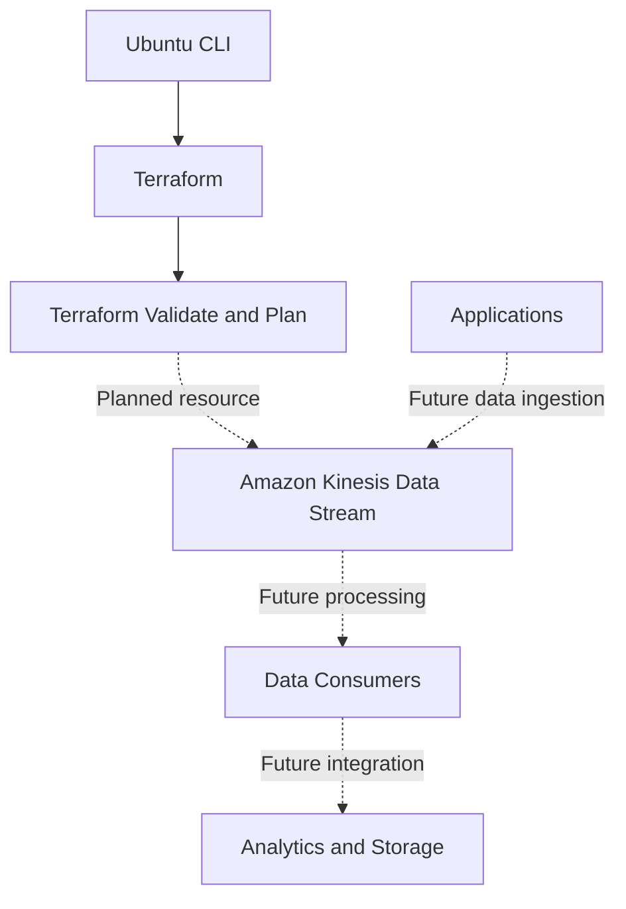

# Amazon Kinesis Terraform Lab

## Project Overview

This project demonstrates how to use Terraform and the
AWS CLI to plan an Amazon Kinesis Data Stream.

It is part of an 11-module AWS Cloud Engineering
hands-on learning portfolio.

**Status: PLAN ONLY — NOT DEPLOYED**

## Architecture



The diagram represents planned infrastructure only.

No Kinesis stream, producer, consumer, or analytics
integration was deployed.

## Technologies

- Amazon Kinesis Data Streams
- AWS Key Management Service
- Terraform
- AWS CLI
- Ubuntu Linux
- Git and GitHub

## Planned Infrastructure

| Resource | Purpose | Status |
|---|---|---|
| aws_kinesis_stream.lab | Streaming data ingestion | Planned |

## Configuration

- AWS Region: us-east-1
- Stream name: terraform-kinesis-lab-stream
- Shard count: 1
- Retention period: 24 hours
- Encryption: KMS
- KMS key: alias/aws/kinesis
- Capacity mode: Provisioned

The AWS-managed KMS key is referenced by the
configuration; this lab does not create a KMS key.

## AWS Discovery

Read-only AWS CLI discovery returned:

```text
StreamNames: []
StreamSummaries: []
Stream count: 0
```

No Kinesis Data Streams were found in us-east-1.

## Terraform Validation

Commands:

```bash
terraform init
terraform fmt -check
terraform validate
terraform plan -input=false -no-color
```

Observed results:

```text
Terraform has been successfully initialized!

Success! The configuration is valid.

Plan: 1 to add, 0 to change, 0 to destroy.
```

## Deployment Status

No terraform apply was executed.

No Kinesis stream was deployed.

No data records were produced or consumed.

## Security and Cost

- The planned stream uses KMS encryption.
- Never commit AWS credentials or private keys.
- Terraform state is excluded from Git.
- Provisioned Kinesis streams can incur ongoing charges.
- AWS KMS usage may incur charges.
- Review IAM permissions before deployment.

## Future Improvements

- Deploy only after explicit authorization.
- Configure least-privilege IAM permissions.
- Build a sample data producer.
- Build a sample data consumer.
- Monitor the stream using CloudWatch.
- Integrate streaming data with analytics services.
- Review costs and clean up resources.

## Validation Evidence

See:

- docs/validation-evidence.md
- screenshots/kinesis-terraform-validation.png
